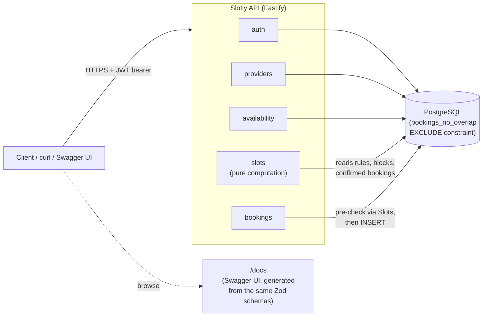

# Slotly

Slotly is a booking API: service providers (consultants, tutors) publish weekly
availability and one-off blocked dates, and customers browse open slots and book
them. It's built to look like production backend code, not a tutorial project:
real validation, a database-enforced concurrency guarantee against double-booking,
timezone/DST-correct slot computation, and a test suite that exercises all of it
against a real Postgres instance rather than mocks.

**Stack:** Node.js 22, TypeScript (strict), Fastify, PostgreSQL 16 + Drizzle ORM,
Zod (shared between request validation and the generated OpenAPI spec), JWT auth
with argon2 password hashing, Vitest + Supertest, Docker, GitHub Actions CI.

**Live docs:** `https://<your-render-service>.onrender.com/docs` _(placeholder -
update once deployed; see [Deployment](#deployment))_.

## Architecture



Each feature is a self-contained module under `src/modules/<feature>/` with its
own `routes` (HTTP + Zod schemas), `service` (business logic), `repository`
(Drizzle queries) and `schemas` (Zod) files. Shared code - errors, auth helpers,
pagination, timezone math - lives in `src/lib/`. Nothing outside a `service`
file talks to business logic; route handlers only validate, call a service, and
shape the HTTP response.

## Endpoints

| Method | Path                                       | Auth     | Description                                                           |
| ------ | ------------------------------------------ | -------- | --------------------------------------------------------------------- |
| GET    | `/health`                                  | -        | Liveness check; pings Postgres                                        |
| POST   | `/auth/register`                           | -        | Create an account (provider or customer)                              |
| POST   | `/auth/login`                              | -        | Log in, get an access + refresh token                                 |
| POST   | `/auth/refresh`                            | -        | Exchange a refresh token for a new pair (rotates it)                  |
| POST   | `/auth/logout`                             | -        | Revoke a refresh token                                                |
| POST   | `/providers`                               | provider | Create your provider profile                                          |
| PATCH  | `/providers/me`                            | provider | Update your provider profile                                          |
| GET    | `/providers/me`                            | provider | Get your own provider profile                                         |
| GET    | `/providers`                               | -        | List providers (paginated, searchable, filterable by price, sortable) |
| GET    | `/providers/:id`                           | -        | Get a provider by id                                                  |
| POST   | `/providers/me/availability-rules`         | provider | Add a weekly recurring availability rule                              |
| GET    | `/providers/:id/availability-rules`        | -        | List a provider's weekly rules                                        |
| DELETE | `/providers/me/availability-rules/:ruleId` | provider | Remove a rule                                                         |
| POST   | `/providers/me/blocked-slots`              | provider | Add a one-off blocked date/time range                                 |
| GET    | `/providers/:id/blocked-slots`             | -        | List a provider's blocked ranges (paginated)                          |
| DELETE | `/providers/me/blocked-slots/:blockId`     | provider | Remove a blocked range                                                |
| GET    | `/providers/:id/slots?from=&to=`           | -        | Open, bookable slots in a date range                                  |
| POST   | `/bookings`                                | customer | Book an open slot                                                     |
| GET    | `/bookings/me`                             | customer | List your own bookings (paginated, filterable by status)              |
| GET    | `/providers/me/bookings`                   | provider | List bookings against your own profile                                |
| POST   | `/bookings/:id/cancel`                     | customer | Cancel a booking (must be >24h before start)                          |

The full request/response schemas are in the generated OpenAPI doc at `/docs`
(interactive) or `/docs/json` (raw spec) once the server is running.

Every error response has the same shape:

```json
{ "error": { "code": "SLOT_NOT_AVAILABLE", "message": "This slot is not available for booking" } }
```

## Running locally

Requires Docker and Node 22 (`.nvmrc` pins the exact version).

```bash
cp .env.example .env
npm install
docker compose up -d db db-test   # dev Postgres (5432) + throwaway test Postgres (5433)
npm run db:migrate
npm run db:seed                   # optional: 3 providers, 5 customers, sample bookings
npm run dev                       # http://localhost:3000/health
```

Or run the whole stack, including migrations, in Docker:

```bash
docker compose up --build         # api (migrates then starts), db, db-test
```

`npm run db:seed` prints the accounts it creates and the shared password they
all use, so you can log in immediately via `/docs` or `curl`.

## Tests

```bash
docker compose up -d db-test
npm test                 # 107+ tests, against the real test Postgres - no mocked DB
npm run test:coverage     # coverage report (text + html + lcov)
```

Tests are split into `test/unit/` (pure functions - slot computation, timezone
conversion, password hashing - no database) and `test/integration/` (every
endpoint, through the real HTTP layer and a real Postgres instance, including
auth failures, validation errors, and a test that fires 10 concurrent booking
requests at the same slot to prove the double-booking guarantee holds under
real concurrency, not just when requests happen to arrive one at a time).

## Deployment

The `Dockerfile`'s final stage (`runtime`) is a small, non-root production
image - no TypeScript, no dev dependencies, no source. This is what both
Render and a plain `docker build .` produce by default, since it's the last
stage in the file.

**Database: [Neon](https://neon.tech) (free tier)**

1. Create a Neon project and copy the **pooled** connection string.
2. Append `?sslmode=require` if it isn't already there.

**API: [Render](https://render.com)**

1. New **Web Service** -> connect this repo -> Environment: **Docker** (Render
   builds the `Dockerfile` directly; no target needs to be specified, since
   `runtime` is already the last stage).
2. Set the **Health Check Path** to `/health`.
3. Add environment variables (see `.env.example` for what each one does):
   - `DATABASE_URL` - the Neon pooled connection string from above
   - `JWT_ACCESS_SECRET` - a long random string (`node -e "console.log(require('crypto').randomBytes(48).toString('base64url'))"`)
   - `NODE_ENV=production`
   - `CORS_ORIGINS` - your frontend's origin(s), comma-separated
   - `JWT_ACCESS_TTL`, `REFRESH_TOKEN_TTL_DAYS`, `RATE_LIMIT_AUTH_MAX` - optional, defaults in `.env.example` are reasonable
   - Render injects `PORT` itself; the app already reads it from the environment.
4. Before the first deploy (and after any future migration), run the migration
   against the Neon database from your machine:
   ```bash
   DATABASE_URL="<neon-pooled-url>?sslmode=require" npm run db:migrate
   ```
   This is a deliberate, separate step rather than something the container
   runs on every boot - see [Design decisions](#design-decisions).
5. Deploy. Swagger UI is live at `https://<your-service>.onrender.com/docs`.

Railway follows the same shape (Docker build, a Postgres add-on or Neon, the
same environment variables, `db:migrate` run once per schema change).

## Design decisions

Three worth knowing before reading the code:

- **Fastify**, because request validation, response serialization, and the
  `/docs` OpenAPI generation all run off the same Zod schemas - one
  contract, not three that can drift apart.
- **A Postgres `EXCLUDE USING gist` constraint, not just an app-level
  check**, is what actually makes double-booking impossible. The app still
  pre-checks for a friendly error, but only the database can make the
  INSERT atomic across two concurrent requests - proven in
  `test/integration/bookings-concurrency.test.ts`, and the full story
  (including a real `deadlock_detected` edge case found while verifying it
  against the production image) is worth reading.
- **Timezones are IANA zone names, never fixed offsets**, because an offset
  is wrong half the year under DST. Weekly rules store provider-local
  minutes-from-midnight (a wall-clock pattern); blocks and bookings store
  absolute UTC (a concrete instant). DST is resolved by looking up the
  zone's real offset at the specific calendar date, not assumed.

Full reasoning, alternatives considered, and more decisions (ORM choice,
password hashing, refresh token design, ownership enforcement) are in
[`ARCHITECTURE_DECISIONS.md`](ARCHITECTURE_DECISIONS.md).

## Other documentation

- [`ARCHITECTURE_DECISIONS.md`](ARCHITECTURE_DECISIONS.md) - the reasoning above, in full, plus more
- [`SECURITY_POLICY.md`](SECURITY_POLICY.md) - what's implemented, and an honest list of what isn't yet
- [`docs/security/SECURITY_AUDIT_REPORT.md`](docs/security/SECURITY_AUDIT_REPORT.md) - a full manual security audit (11 findings, 0 critical, 1 high) with evidence from actually testing the running app, not just reading the code
- [`docs/security/SECURITY_REMEDIATION_LOG.md`](docs/security/SECURITY_REMEDIATION_LOG.md) - tracks each audit finding from identification to verified fix
- [`ERROR_HANDLING.md`](ERROR_HANDLING.md) - every error code the API can return, and why
- [`TASKS.md`](TASKS.md) - completed work and the structured backlog (what I'd add next, and why)
- [`CHANGELOG.md`](CHANGELOG.md) - version history
- [`AI_CONTEXT.md`](AI_CONTEXT.md) - orientation for an AI agent (or a new contributor) picking this up cold
- [`MASTER_PROJECT_INSTRUCTIONS.md`](MASTER_PROJECT_INSTRUCTIONS.md) - the engineering framework this documentation set follows
